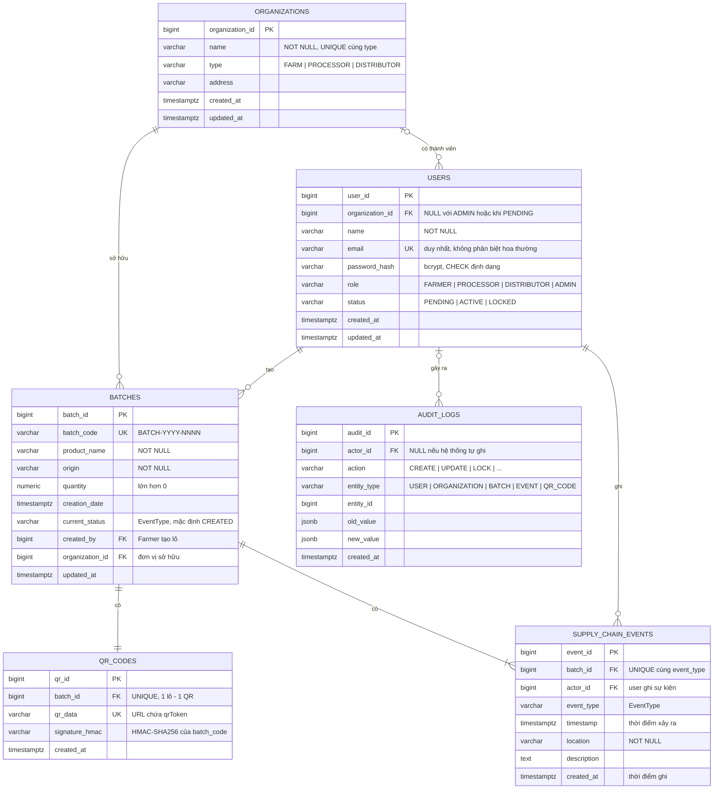

# ERD v3 – Cơ sở dữ liệu (W3-TV3)

**Dự án:** Food Supply Chain Traceability & Provenance Portal – Nhóm 13
**Người phụ trách:** Đặng Vĩnh Quang (TV3 - Database / Auth / Security)
**Người review:** Chung Nguyễn Minh Trí (TV2 - Backend / API)
**Hệ quản trị:** PostgreSQL 16
**Bàn giao tuần 3:** `docs/ERD/ERD-v3.pdf` (sơ đồ), `database/schema.sql` (schema v1), `database/tests/schema-check.sql` (39 ca kiểm tra ràng buộc).

ERD v3 thay cho bản nháp v2 (`erd-draft.md`). Tên bảng và cột được thống nhất với Class Diagram (`docs/UML/class-diagram.dot`) và OpenAPI (`docs/openapi-spec.yaml`, bản W3-TV2): CSDL dùng `snake_case`, API dùng `camelCase` tương ứng.

## 1. Sơ đồ



Bản in: [`ERD-v3.pdf`](ERD-v3.pdf) · ảnh: [`ERD-v3.png`](ERD-v3.png).

## 2. Từ điển dữ liệu

### 2.1 `organizations`
| Cột | Kiểu | Ràng buộc | API |
| --- | --- | --- | --- |
| organization_id | BIGINT IDENTITY | PK | organizationId |
| name | VARCHAR(150) | NOT NULL, không rỗng; UNIQUE (name, type) | name |
| type | VARCHAR(20) | CHECK FARM / PROCESSOR / DISTRIBUTOR; không đổi khi đã có thành viên hoặc lô | type ⚠️ |
| address | VARCHAR(255) | | address ⚠️ |
| created_at, updated_at | TIMESTAMPTZ | NOT NULL, mặc định now() | – |

### 2.2 `users`
| Cột | Kiểu | Ràng buộc | API |
| --- | --- | --- | --- |
| user_id | BIGINT IDENTITY | PK | userId |
| organization_id | BIGINT | FK → organizations, RESTRICT; NULL với ADMIN; bắt buộc khi ACTIVE (trừ ADMIN); loại đơn vị phải khớp vai trò | organizationId |
| name | VARCHAR(100) | NOT NULL, không rỗng | name |
| email | VARCHAR(255) | NOT NULL, định dạng email; UNIQUE trên `lower(email)` | email |
| password_hash | VARCHAR(255) | NOT NULL; CHECK đúng định dạng bcrypt (chặn lưu mật khẩu thô) | **không bao giờ trả ra** |
| role | VARCHAR(20) | CHECK FARMER / PROCESSOR / DISTRIBUTOR / ADMIN | role |
| status | VARCHAR(20) | CHECK PENDING / ACTIVE / LOCKED; mặc định PENDING | status |
| created_at, updated_at | TIMESTAMPTZ | NOT NULL | – |

### 2.3 `batches`
| Cột | Kiểu | Ràng buộc | API |
| --- | --- | --- | --- |
| batch_id | BIGINT IDENTITY | PK | batchId |
| batch_code | VARCHAR(30) | NOT NULL, UNIQUE (có chỉ mục), CHECK `^BATCH-[0-9]{4}-[0-9]{4,}$` | batchCode |
| product_name | VARCHAR(150) | NOT NULL, không rỗng | productName |
| origin | VARCHAR(255) | NOT NULL, không rỗng | origin |
| quantity | NUMERIC(12,2) | NOT NULL, > 0 | quantity |
| creation_date | TIMESTAMPTZ | NOT NULL, mặc định now(), không sửa | creationDate |
| current_status | VARCHAR(20) | CHECK thuộc EventType; mặc định CREATED; chỉ tiến một bước | currentStatus |
| created_by | BIGINT | FK → users, RESTRICT; phải là Farmer ACTIVE của đơn vị sở hữu | createdBy |
| organization_id | BIGINT | FK → organizations, RESTRICT; NOT NULL | organizationId ⚠️ |
| updated_at | TIMESTAMPTZ | NOT NULL | – |

### 2.4 `qr_codes`
| Cột | Kiểu | Ràng buộc | API |
| --- | --- | --- | --- |
| qr_id | BIGINT IDENTITY | PK | qrId |
| batch_id | BIGINT | FK → batches, RESTRICT; UNIQUE (1 lô – 1 QR) | batchId |
| qr_data | VARCHAR(512) | NOT NULL, UNIQUE; phải chứa signature_hmac | qrData |
| signature_hmac | VARCHAR(128) | NOT NULL | (nội bộ) |
| created_at | TIMESTAMPTZ | NOT NULL | createdAt |

`qrToken = <batch_code>.<signature_hmac>`, `signature_hmac = base64url(HMAC-SHA256(QR_HMAC_SECRET, batch_code))` (SRS P1). Khóa `QR_HMAC_SECRET` chỉ nằm trong biến môi trường, không lưu trong CSDL.

### 2.5 `supply_chain_events` (append-only)
| Cột | Kiểu | Ràng buộc | API |
| --- | --- | --- | --- |
| event_id | BIGINT IDENTITY | PK | eventId |
| batch_id | BIGINT | FK → batches, RESTRICT; UNIQUE (batch_id, event_type) | batchId |
| actor_id | BIGINT | FK → users, RESTRICT; phải ACTIVE và đúng vai trò của loại sự kiện | actorId |
| event_type | VARCHAR(20) | CHECK thuộc EventType; đúng thứ tự | eventType |
| timestamp | TIMESTAMPTZ | NOT NULL, mặc định now() | timestamp |
| location | VARCHAR(255) | NOT NULL, không rỗng | location |
| description | TEXT | | description |
| created_at | TIMESTAMPTZ | NOT NULL | – |

Chỉ mục `(batch_id, timestamp)` phục vụ lấy timeline.

### 2.6 `audit_logs` (append-only)
| Cột | Kiểu | Ràng buộc | API |
| --- | --- | --- | --- |
| audit_id | BIGINT IDENTITY | PK | auditId |
| actor_id | BIGINT | FK → users, RESTRICT; NULL khi không xác định được người dùng | actorId |
| action | VARCHAR(50) | CHECK CREATE / UPDATE / REGISTER / LOGIN_FAILED / APPROVE / CHANGE_ROLE / LOCK / UNLOCK / ASSIGN_ORGANIZATION | action |
| entity_type | VARCHAR(30) | CHECK USER / ORGANIZATION / BATCH / EVENT / QR_CODE | entityType |
| entity_id | BIGINT | | entityId |
| old_value, new_value | JSONB | CHECK không chứa khóa password / token / signature | oldValue, newValue |
| created_at | TIMESTAMPTZ | NOT NULL | createdAt |

Chỉ mục `(entity_type, entity_id)`, `(actor_id)`, `(created_at DESC)` phục vụ `GET /audit-logs` có lọc.

## 3. Trạng thái lô và loại sự kiện (đã chốt)

Dùng một enum `EventType` cho cả `batches.current_status` và `supply_chain_events.event_type`, theo OpenAPI và Class Diagram:

| Thứ tự | EventType | Vai trò được ghi |
| --- | --- | --- |
| 1 | CREATED | FARMER (hệ thống ghi khi tạo lô) |
| 2 | TRANSPORTED | DISTRIBUTOR |
| 3 | RECEIVED | DISTRIBUTOR |
| 4 | PROCESSED | PROCESSOR |
| 5 | PACKAGED | PROCESSOR |
| 6 | SHIPPED | DISTRIBUTOR |

Sự kiện mới phải là bước kế tiếp của `current_status`. INSERT sự kiện hợp lệ thì CSDL tự cập nhật `batches.current_status` trong cùng transaction.

## 4. Quy tắc dữ liệu được CSDL tự bảo vệ

Các quy tắc dưới đây vẫn phải được kiểm tra ở backend để trả mã lỗi đúng (400/403/404/409). CSDL là lớp chặn cuối, để dữ liệu không sai kể cả khi backend có lỗi hoặc có người thao tác trực tiếp trên CSDL.

| # | Quy tắc | Cơ chế | Nguồn |
| --- | --- | --- | --- |
| R1 | Không lưu mật khẩu thô | CHECK định dạng bcrypt | NFR-02 |
| R2 | Email duy nhất, không phân biệt hoa thường | UNIQUE INDEX `lower(email)` | US-UI01 |
| R3 | Vai trò khớp loại đơn vị; Admin không thuộc đơn vị; ACTIVE phải có đơn vị | CHECK + trigger `check_user_rules` | US-S01 |
| R4 | Không hạ quyền hoặc khóa Admin ACTIVE cuối cùng | trigger `check_user_rules` | US-S01, US-S04 |
| R5 | Không đổi loại đơn vị đã có thành viên hoặc lô; không xóa đơn vị đang dùng | trigger + FK RESTRICT | US-S03 |
| R6 | Chỉ Farmer ACTIVE tạo lô cho đơn vị mình; `batch_code` duy nhất; `quantity > 0` | CHECK + UNIQUE + trigger `check_batch_rules` | US-B01 |
| R7 | Chỉ sửa thông tin lô khi còn CREATED; không sửa mã lô, người tạo, đơn vị | trigger `check_batch_rules` | US-B02 |
| R8 | Mỗi lô đúng một QR | UNIQUE `qr_codes.batch_id` | FR-QR-01 |
| R9 | Sự kiện đúng vai trò, đúng thứ tự, không trùng; người ghi phải ACTIVE | trigger `check_event_rules` + UNIQUE | US-B05, US-S04 |
| R10 | `supply_chain_events` và `audit_logs` chỉ INSERT (chặn UPDATE / DELETE / TRUNCATE) | trigger `forbid_modification` | US-S05, US-S06 |
| R11 | Audit không chứa mật khẩu, token, chữ ký | CHECK `chk_audit_no_secrets` | US-S05 AC03 |
| R12 | Không xóa lô | FK RESTRICT từ qr_codes / events; không có endpoint DELETE | FR-BATCH |
| R13 | Dữ liệu công khai không lộ id nội bộ, email | view `public_batch_trace`, `public_event_trace` | FR-QR-06 |

## 5. Điểm lệch với Class Diagram / OpenAPI (cần TV2 cập nhật)

| # | Nội dung | Lý do giữ trong CSDL | Đề xuất |
| --- | --- | --- | --- |
| D1 | `Organization` trong Class Diagram chỉ có `organizationId`, `name` | Cần `type` để kiểm tra vai trò ↔ đơn vị (US-S01) và quản lý đơn vị (US-S03) | Thêm `type`, `address` vào Class Diagram |
| D2 | `Batch` không có `organizationId` | Phạm vi đọc/sửa của Farmer theo đơn vị (FR-BATCH-08); `PublicTrace.organizationName` cần biết đơn vị sở hữu | Thêm `organizationId` vào Class Diagram và schema `Batch` |
| D3 | Enum `Role` có `CONSUMER` | Consumer không có tài khoản (ma trận quyền, SRS 2.1), nên CSDL không lưu | Bỏ `CONSUMER` khỏi `Role`, hoặc ghi chú "không lưu trong users" |
| D4 | OpenAPI chưa có endpoint quản trị `/users`, `/users/{id}/role`, `/users/{id}/status`, `/organizations`, `/audit-logs` | Có trong ma trận quyền và US-S01, S03, S04, S06 | Bổ sung trước tuần 4 |
| D5 | Bản nháp v2 có bảng `product` | Class Diagram/OpenAPI để `productName` trực tiếp trên `Batch` | **Đã theo UML**: bỏ bảng `product` |

## 6. Thay đổi so với ERD v2 (`erd-draft.md`)

| Thay đổi | Lý do |
| --- | --- |
| Bỏ bảng `product`, thêm `batches.product_name` | Thống nhất với Class Diagram / OpenAPI (D5) |
| Tên bảng số nhiều (`users`, `batches`…) | `user` là từ khóa của PostgreSQL |
| `batches.production_date` → `creation_date` | Thống nhất với `creationDate` của API |
| `supply_chain_events.event_time` → `timestamp` | Thống nhất với API |
| `qr_codes.token` → `qr_data` + `signature_hmac` | Thống nhất với Class Diagram (`qrData`, `signatureHMAC`) và SRS P1 |
| `audit_logs.entity`, `detail` → `entity_type`, `old_value`, `new_value` | Thống nhất với Class Diagram |
| Chốt 6 trạng thái CREATED → SHIPPED | OpenAPI W3, SRS mục 10 #10 |
| Thêm UNIQUE `(batch_id, event_type)`, trigger thứ tự, trigger append-only, view công khai | Bảo vệ toàn vẹn chuỗi ở mức CSDL |

## 7. Cách chạy và kiểm tra

```bash
# Tạo schema trên CSDL trống (ví dụ container database trong docker-compose)
psql -h localhost -U postgres -d food_traceability -v ON_ERROR_STOP=1 -f database/schema.sql

# Kiểm tra 39 ràng buộc (dữ liệu thử được ROLLBACK, CSDL giữ nguyên)
psql -h localhost -U postgres -d food_traceability -v ON_ERROR_STOP=1 -f database/tests/schema-check.sql
```

Kết quả mong đợi: mọi dòng `PASS ...` và dòng cuối `ALL CHECKS PASSED`.
