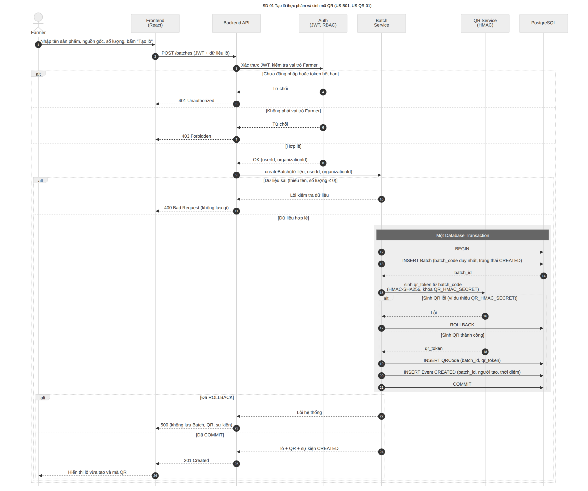
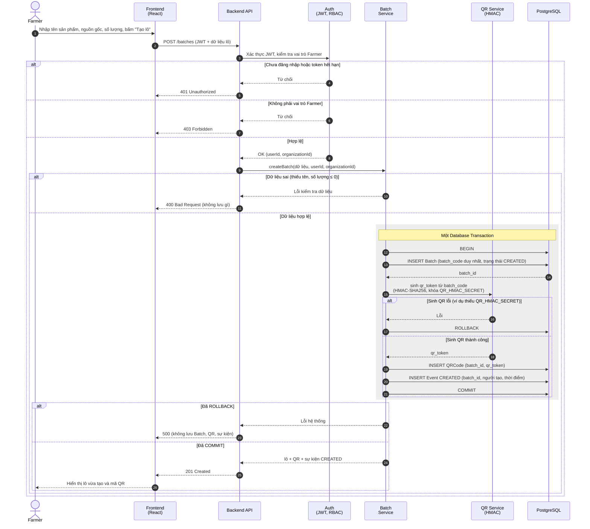
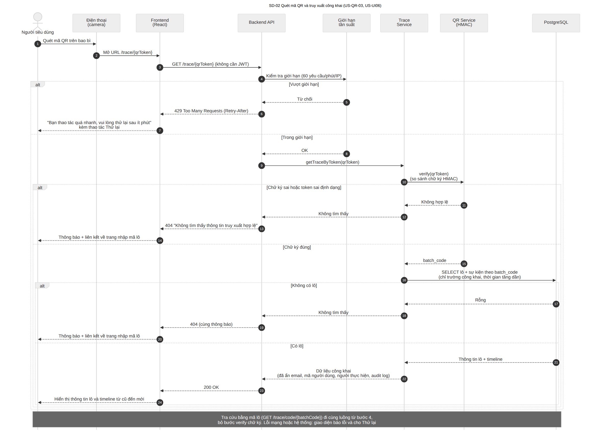
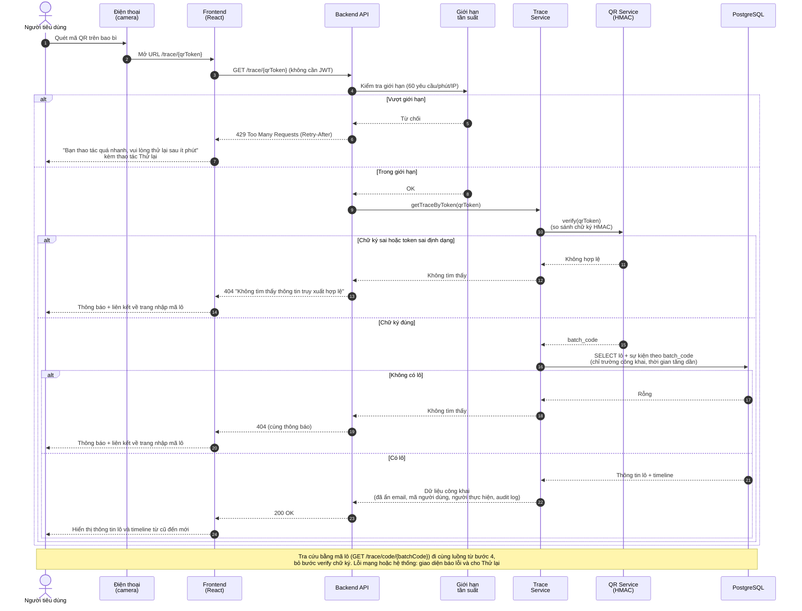
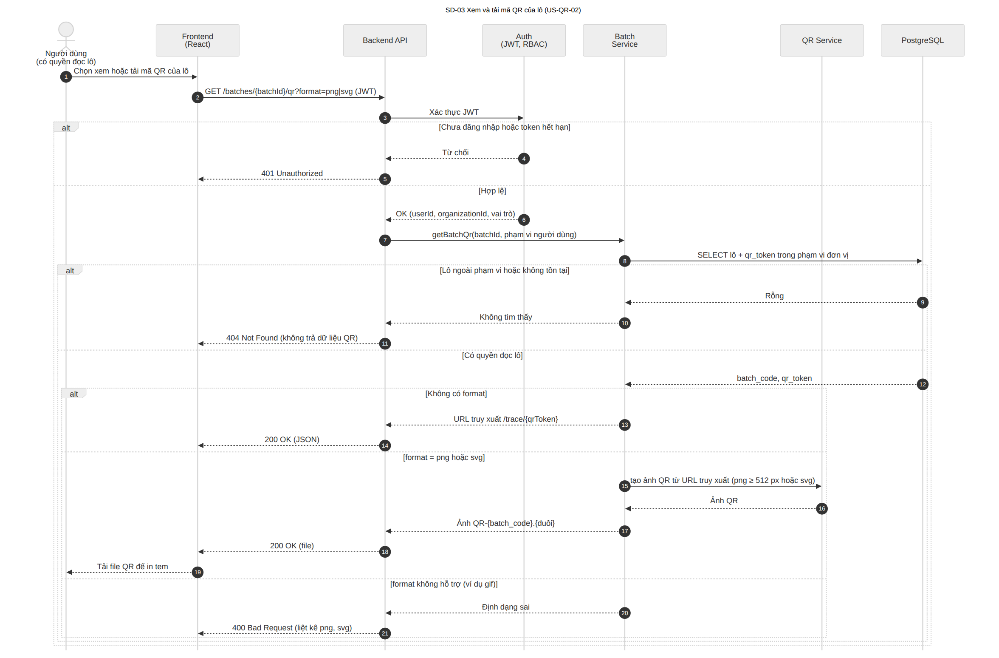
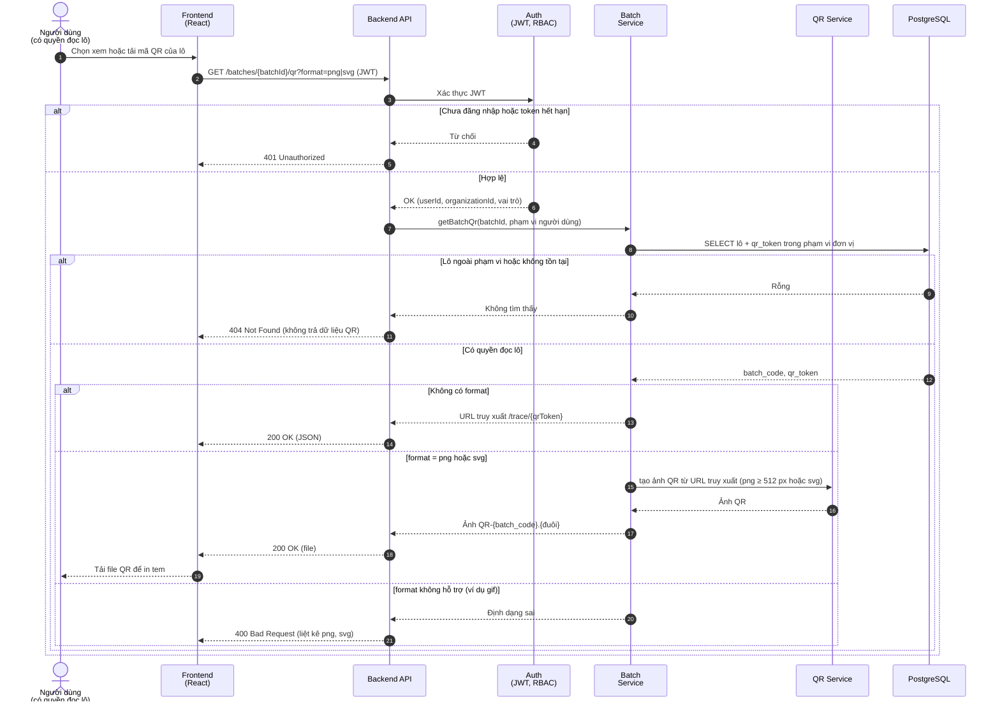

# Sequence Diagram – TV4 (Tuần 3)

> Bàn giao W3-TV4: Sequence Diagram cho **tạo lô** và **quét QR** (kèm xem/tải QR).
> Người lập: TV4 | Người review: TV3 | Ảnh PNG (độ phân giải cao) và mã nguồn Mermaid: thư mục [`sequence/`](sequence)
> Các sơ đồ bám theo SRS v1.5 (`docs/SRS/SRS-v1.md`), `user-stories-tv4.md` và `user-stories-batch.md`. Trong sơ đồ, **Auth (JWT, RBAC)**, **QR Service** và **Trace Service** là thành phần logic; tên lớp cụ thể sẽ thống nhất với Class Diagram của TV2.

## Quy ước
- Đường liền là yêu cầu, đường đứt là phản hồi; số thứ tự ở mỗi mũi tên là thứ tự thực hiện.
- Khung `alt` là các nhánh điều kiện (thành công, lỗi, ngoài quyền); khung nền xám là phạm vi Database Transaction.
- Mã lỗi: 401 chưa đăng nhập hoặc token hết hạn, 403 sai vai trò, 404 ngoài phạm vi hoặc không tồn tại, 400 dữ liệu sai, 429 vượt giới hạn tần suất.

## SD-01. Tạo lô thực phẩm và sinh mã QR

| Thông tin | Nội dung |
|---|---|
| User Story | US-B01 (TV2), US-QR-01 |
| Yêu cầu chức năng | FR-BATCH-01..03, FR-BATCH-12, FR-QR-01, FR-QR-02 |
| Ca kiểm thử | TC-BATCH-01..03, TC-QR-01..04 (xem `docs/test/test-plan.md`) |

**Diễn giải**

- Farmer tạo lô qua `POST /batches`; hệ thống kiểm tra JWT và vai trò trước khi xử lý (401 chưa đăng nhập, 403 sai vai trò).
- Batch, QRCode và sự kiện `CREATED` được ghi trong **một Database Transaction**. `qr_token` có chữ ký HMAC-SHA256 tạo bằng khóa `QR_HMAC_SECRET`.
- Nếu sinh QR lỗi (ví dụ thiếu khóa) thì ROLLBACK toàn bộ, trả 500 và không để lại Batch, QR hay sự kiện nào.
- Dữ liệu sai (thiếu tên, số lượng ≤ 0) trả 400 trước khi mở transaction.



<details><summary>Mã nguồn Mermaid (GitHub tự hiển thị)</summary>



</details>

## SD-02. Quét mã QR và truy xuất công khai

| Thông tin | Nội dung |
|---|---|
| User Story | US-QR-03, US-UI05, US-UI06 (TV1) |
| Yêu cầu chức năng | FR-QR-05..08, FR-UI-14..18 |
| Ca kiểm thử | TC-QR-11..17, TC-UI-05..09 (xem `docs/test/test-plan.md`) |

**Diễn giải**

- Người tiêu dùng quét QR, mở `/trace/{qrToken}`; endpoint công khai không yêu cầu JWT.
- Giới hạn tần suất (60 yêu cầu/phút/IP) được kiểm tra trước; vượt giới hạn trả 429 kèm `Retry-After`.
- Hệ thống xác minh chữ ký HMAC của token. Token sai chữ ký, sai định dạng hoặc không có lô tương ứng đều trả **cùng một** 404 "Không tìm thấy thông tin truy xuất hợp lệ" để không lộ lý do.
- Dữ liệu trả về chỉ gồm trường công khai; email, mã người dùng, người thực hiện và audit log được ẩn.
- Tra cứu bằng mã lô (`GET /trace/code/{batchCode}`) đi cùng luồng, bỏ bước xác minh chữ ký.



<details><summary>Mã nguồn Mermaid (GitHub tự hiển thị)</summary>



</details>

## SD-03. Xem và tải mã QR của lô

| Thông tin | Nội dung |
|---|---|
| User Story | US-QR-02 |
| Yêu cầu chức năng | FR-QR-03, FR-QR-04, FR-BATCH-12 |
| Ca kiểm thử | TC-QR-05..10 (xem `docs/test/test-plan.md`) |

**Diễn giải**

- Người dùng có quyền đọc lô gọi `GET /batches/{batchId}/qr` (JWT). Endpoint này là **đề xuất**, cần đối chiếu OpenAPI.
- Lô ngoài phạm vi đơn vị hoặc không tồn tại trả 404; chưa đăng nhập trả 401.
- Không kèm `format` thì trả URL truy xuất (JSON); `format=png` (≥ 512 px) hoặc `svg` thì trả file `QR-{batch_code}.{đuôi}`; định dạng khác trả 400.



<details><summary>Mã nguồn Mermaid (GitHub tự hiển thị)</summary>



</details>

## Điểm chờ xác nhận
- Cấu trúc `qr_token` và tên biến `QR_HMAC_SECRET` (chờ TV2), xem SRS mục 11 (P1, P2).
- Endpoint `GET /batches/{batchId}/qr` và định dạng phản hồi (chờ TV2), SRS mục 11 (P3).
- Mã lỗi khi truy cập ngoài phạm vi (404) và thông báo lỗi truy xuất dùng chung (chờ TV3, TV1), SRS mục 10.
- Tên lớp và thành phần trong sơ đồ cần khớp Class Diagram (TV2) và ERD (TV3) để đạt mốc "tên dữ liệu thống nhất" của Tuần 3.

## Cách xuất lại ảnh PNG
```bash
npm install -g @mermaid-js/mermaid-cli
mmdc -i docs/UML/sequence/SD-01-tao-lo-sinh-qr.mmd -o docs/UML/sequence/SD-01-tao-lo-sinh-qr.png -s 3 -b white
```
