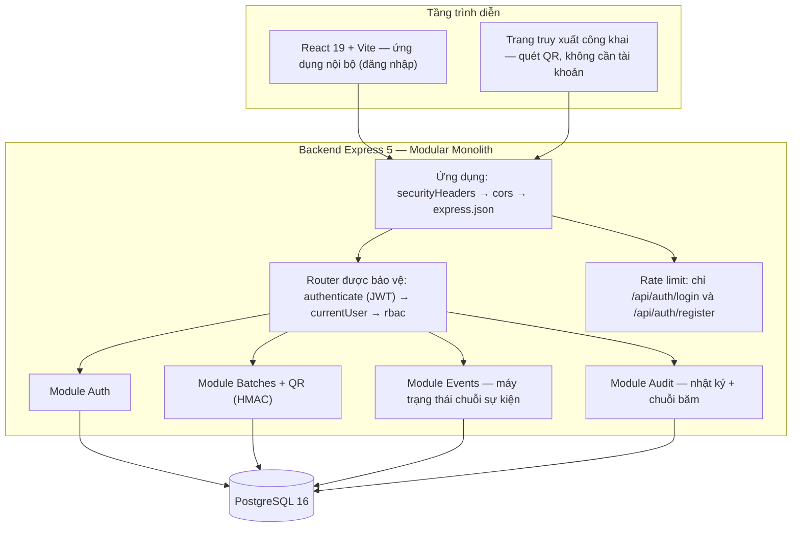

# Kiến trúc hệ thống — Food Supply Chain Traceability Portal

## 1. Lựa chọn kiến trúc

Hệ thống được xây dựng theo kiến trúc Client–Server với giao diện lập trình REST API, tổ chức theo kiến trúc phân lớp (Layered Architecture) 3 tầng, backend theo mô hình Monolith phân module (Modular Monolith).

Lý do lựa chọn gắn với đặc thù chức năng của đề tài:

- Hệ thống có hai nhóm người dùng rất khác nhau: người dùng nội bộ (Farmer, Processor, Distributor, Admin) thao tác qua giao diện web sau đăng nhập, và người tiêu dùng chỉ quét mã QR bằng điện thoại để xem thông tin công khai. Client–Server + REST cho phép một backend duy nhất phục vụ cả hai nhóm qua cùng một API, trong đó endpoint truy xuất công khai được tách riêng về cơ chế bảo vệ (token QR có chữ ký) so với endpoint nội bộ (JWT + phân quyền).
- Nghiệp vụ truy xuất nguồn gốc có quy tắc thứ tự sự kiện chặt chẽ (một lô hàng phải đi đúng chuỗi CREATED → TRANSPORTED → RECEIVED → PROCESSED → PACKAGED → SHIPPED) và yêu cầu toàn vẹn lịch sử (không được sửa/xóa sự kiện đã ghi). Tầng nghiệp vụ tập trung (service) là nơi duy nhất thực thi các quy tắc này, còn tầng dữ liệu hỗ trợ bằng ràng buộc chỉ-thêm-mới và chuỗi băm — đây là lý do hệ thống cần một tầng Application rõ ràng thay vì để giao diện truy cập thẳng CSDL.
- Quy mô nhóm 4 thành viên và thời gian 8 tuần phù hợp với Modular Monolith: mỗi thành viên phụ trách một module nhưng vẫn triển khai và kiểm thử chung một hệ thống, tránh chi phí vận hành của Microservices.

## 2. Sơ đồ kiến trúc

## 3. Các tầng kiến trúc và ánh xạ với chức năng

| Tầng / thành phần | Công nghệ | Chức năng đảm nhiệm | Nơi trong mã nguồn |
|---|---|---|---|
| Trình diễn — ứng dụng nội bộ | React 19 SPA (Vite) | Đăng nhập/đăng ký, quản lý lô hàng, ghi sự kiện, xem timeline, dashboard theo vai trò | `frontend/src/` |
| Trình diễn — trang truy xuất công khai (dự kiến, chờ PR #59) | React route trace + thư viện qrcode | Kế hoạch tuần 7: người tiêu dùng xem nguồn gốc và timeline qua QR | `frontend/src/trace/` (phần giao diện đã có); endpoint backend chờ PR #59 |
| Ứng dụng — middleware toàn cục | Express middleware | `securityHeaders` → `cors` → `express.json` | `backend/src/app.js` |
| Ứng dụng — middleware theo router và rate limit | Express middleware | Router bảo vệ dùng JWT, nạp user hiện tại và RBAC; rate limit chỉ áp dụng cho `/api/auth/login` và `/api/auth/register` | `backend/src/middleware/`, các `*.routes.js` |
| Ứng dụng — Module Auth | Express (routes/controller/service/repository) | Đăng ký, đăng nhập, hồ sơ cá nhân, vai trò và trạng thái tài khoản (PENDING/ACTIVE/LOCKED) | `backend/src/modules/auth/` |
| Ứng dụng — Module Batches | Express (routes/controller/service/repository) | Tạo lô (mã lô tự sinh BATCH-YYYY-NNNN), sửa lô khi còn CREATED, phạm vi xem theo đơn vị, sinh token QR ký HMAC | `backend/src/modules/batches/`, `backend/src/common/qrToken.js` |
| Ứng dụng — Module Events | Express (routes/controller/service/repository) | Ghi sự kiện chuỗi cung ứng, kiểm tra máy trạng thái thứ tự (sai thứ tự → 409 INVALID_SEQUENCE), timeline của lô | `backend/src/modules/events/` |
| Ứng dụng — Module Audit | Express (routes/controller/service/repository) | Nhật ký kiểm toán chỉ-thêm-mới cho mọi thao tác, chuỗi băm chống sửa đổi, tra cứu nhật ký cho Admin | `backend/src/modules/audit/` |
| Dữ liệu | PostgreSQL 16, pg Pool | 7 migration (001–007): schema, bảng vai trò, sản phẩm/nông trại, loại sự kiện, chuỗi băm lịch sử, vai trò CSDL tối thiểu fsc_app và chỉ mục truy vấn (007) | `database/migrations/`, `backend/src/db/` |

Mỗi module của backend đều tổ chức 4 lớp `routes → controller → service → repository`: routes gắn đường dẫn và middleware, controller điều phối HTTP, service thực thi quy tắc nghiệp vụ, repository là nơi duy nhất chạm vào CSDL.

## 4. Cơ chế vận hành

Luồng xử lý request: HTTP request đi qua middleware toàn cục `securityHeaders` → `cors` → `express.json`; các router cần xác thực tiếp tục qua JWT, nạp trạng thái tài khoản và RBAC. Rate limit hiện chỉ gắn cho `/api/auth/login` và `/api/auth/register`. Sau đó routes chuyển tới controller → service → repository truy vấn PostgreSQL; các thao tác thay đổi dữ liệu đồng thời ghi nhật ký qua Module Audit. Endpoint `/trace` là kế hoạch tuần 7, đang chờ PR #59 merge.

Bốn cơ chế đặc thù của hệ thống:

1. **Xác thực không trạng thái (stateless) bằng JWT + phân quyền RBAC:** sau đăng nhập, server cấp JWT; mỗi request tự mang theo token nên server không lưu session. Quyền được kiểm hai lớp: theo vai trò (permission như `batch:create`, `event:create`, `qr:read`) và theo phạm vi đơn vị (người dùng chỉ thấy lô của tổ chức mình; ngoài phạm vi trả 404 thay vì 403 để không lộ sự tồn tại của dữ liệu).
2. **Máy trạng thái (state machine) cho chuỗi sự kiện:** trạng thái lô hàng chỉ được chuyển theo đúng thứ tự CREATED → TRANSPORTED → RECEIVED → PROCESSED → PACKAGED → SHIPPED, mỗi loại sự kiện chỉ do đúng vai trò ghi (TRANSPORTED/RECEIVED/SHIPPED — Distributor; PROCESSED/PACKAGED — Processor). Ghi sai thứ tự bị từ chối bằng lỗi 409 INVALID_SEQUENCE và không làm thay đổi dữ liệu.
3. **Lịch sử chỉ-thêm-mới + chuỗi băm (hash chain):** sự kiện và nhật ký kiểm toán không có đường sửa/xóa (trigger ở tầng CSDL + vai trò fsc_app bị tước quyền UPDATE/DELETE trên bảng lịch sử); mỗi dòng nhật ký chứa mã băm liên kết với dòng trước, nên sửa đổi một dòng trong quá khứ sẽ làm đứt toàn bộ chuỗi phía sau và bị phát hiện khi kiểm chứng.
4. **Mã QR ký HMAC và truy xuất công khai dự kiến:** token QR có dạng mã lô + `.` + chữ ký HMAC-SHA256 (`QR_HMAC_SECRET` tối thiểu 32 ký tự); chữ ký kiểm bằng `timingSafeEqual`. Endpoint `/trace`, giới hạn tần suất và DTO công khai đang chờ PR #59 (W7-TV2) merge.

## 5. Nền tảng và công cụ

| Thành phần | Công nghệ / công cụ thật | Ghi chú |
|---|---|---|
| Frontend | React 19, Vite, thư viện qrcode | SPA thuần, không dùng Next.js |
| Backend | Node.js, Express 5, REST API | Kiểm thử bằng `node --test` |
| Cơ sở dữ liệu | PostgreSQL 16, thư viện pg | Quản lý thay đổi bằng migration 001–007; 007 thêm chỉ mục truy vấn |
| Xác thực / bảo mật | JWT (jsonwebtoken), bcryptjs, HMAC-SHA256 | RBAC theo ma trận quyền `docs/permission-matrix.md` |
| Đặc tả API | OpenAPI (`docs/openapi-spec.yaml`) | Là hợp đồng API giữa frontend và backend |
| Triển khai | Docker, Docker Compose (3 service: frontend, backend, database) | `docker-compose.yml` + Dockerfile từng phần |
| Quản lý mã nguồn / CI | GitHub, GitHub Actions (CI: cài đặt → lint → test → build ở mỗi PR) | Quy ước nhóm là chờ review và CI xanh; branch protection cho main hiện chưa bật |
| Quản lý công việc | GitHub Issues/Projects, tài liệu trong `docs/` (SRS, UML, ERD) | Theo kế hoạch 8 tuần của nhóm |
